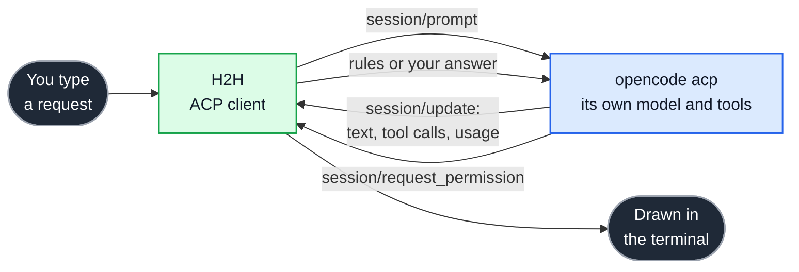

# ACP: H2H

A demo of driving a harness over the Agent Client Protocol (ACP), rather than through its terminal, so the two can be compared before deciding which way H2H goes. **It exists only on the `demo/acp` branch.** Recorded on 2026-11-26.

## What ACP is

ACP is an open protocol, started by Zed, between a program that shows an agent's work (the **client**) and a coding agent (the **agent**). It plays the part for coding agents that LSP plays for language servers. The client starts the agent and they exchange JSON-RPC messages over its standard input and output.

The agent still does all the work. It uses its own login, model, prompts, tools and settings, as it does in its terminal. ACP only replaces the agent's screen. The agent reports what it does as messages, and the client sends it the user's requests and answers its questions. No model API or token passes through the client.

| Protocol | Between | In H2H |
|---|---|---|
| ACP | A client and an agent | H2H driving a harness |
| MCP | An agent and its tools | A harness calling tools H2H offers |
| A2A | Two agents, often remote | Remote harnesses, in the design |

## Trying it

```sh
git switch demo/acp
go build -o bin/h2h ./cmd/h2h
cd <a scratch git repository>
<path to H2H>/bin/h2h acp opencode
```

Or `/acp` in the console, which hands it the terminal as `attach` does and takes it back on `/quit`.

| Typed | Does |
|---|---|
| A request | Sent to the harness. Its messages, thoughts and tool calls are drawn as they come |
| Ctrl-C | Stops the turn (`session/cancel`). At the prompt, leaves |
| `/model`, `/mode` | Shows the setting and its values; with a value, changes it for the session |
| `/options` | Shows every setting the harness offers |
| `/quit` | Leaves. The harness stops |

When the harness asks permission for a tool, H2H answers from the `[permissions]` rules of `h2h.toml`, as for the hooks in [permissions.md](permissions.md). Where no rule covers it, H2H asks on the next line: `y` allow once, `a` allow for the session, `n` refuse.

**The demo works in the project's folder itself, not in a workspace of its own.** What the harness changes is changed in the project. Use a scratch repository.

## How it works



- **`internal/acp`** is the client: start the agent, `initialize`, `session/new`, `session/prompt`, `session/cancel`, `session/set_config_option`, and answering `session/request_permission`. It offers the agent no file system or terminal of its own, so the agent uses its own tools. It is written from the protocol's messages as observed, with no ACP library.
- **`internal/cli/acp.go`** is the `acp` command: it draws the session and applies the permission rules.
- **Config** says how to run a harness as an agent: `acp_command`, the whole command, and `acp_env`, set for it. OpenCode's entry sets its permissions for bash, edits and web fetches to "ask", so those questions come to H2H rather than being allowed by OpenCode's default.

## What was verified

On OpenCode 2.4.1, in a scratch repository, with its free model `opencode/big-pickle`:

| Checked | Result |
|---|---|
| Start and `initialize` | OpenCode reports its version and its capabilities: loading, resuming, forking and listing sessions, images and embedded context in prompts, MCP servers over HTTP |
| `session/new` | Returns the session's ID and two settings, `model` (eleven free models were offered) and `mode` (`build` or `plan`), and lists OpenCode's own slash commands (`/init`, `/review`, `/goal`, `/compact` and more) |
| Changing the model and mode | `session/set_config_option` changed both, with no model call |
| A request | Text, tool calls with their status and the command they run, token use against the context size, and the cost (0 USD on the free model) all arrived as messages. The turn ended with `end_turn` |
| An allow rule | `git status --short` was allowed by `allow = ["git status*"]` and ran with no question |
| A deny rule | `rm README.md` was refused by `deny = ["rm *"]`, and the file was not removed |
| No rule | `echo hi > hello.txt` was put to the user, allowed with `y`, and ran |
| A refusal | **OpenCode ended its turn with `cancelled`** on the refusal, so later steps of the request did not run. ACP's answer to a permission request has no message for the model. H2H now sends a request of its own that says what was refused and why, as the hooks' deny message does. OpenCode then carried on with the rest and said in its answer that the removal was not allowed |

The client is also tested against a stand-in agent (`internal/acp/acp_test.go`): a turn with a permission allowed and refused, cancelling while a question is open, and changing a setting.

Not checked: Ctrl-C on a real turn, the `/acp` view in the full-screen console, a long session, and any harness other than OpenCode.

### Seen along the way

- **OpenCode sends its reasoning as ordinary message text,** not as thought chunks, so it shows as part of the answer.
- **A request carries the tool's raw input,** such as the command, but the title can change while the call runs: it is "shell" when pending and the command once it starts.

## Compared with the terminal

| | Terminal (what H2H does now) | ACP (this demo) |
|---|---|---|
| Sending work | Typed into the harness's terminal. Guarded against trust questions and screens that take the keys | A message. It cannot go to the wrong place |
| Knowing it arrived | The prompt hook confirms it, where the harness has one | The reply to the request |
| Working, waiting, done | From hooks the harness may or may not have; silence otherwise | From messages, for every harness that speaks ACP |
| Permission questions | A hook per harness, wired on one of five today | Part of the protocol |
| Telling a refused model why | In the hook's answer | Not in the protocol: H2H sends a follow-up request |
| Changing model or mode | Not built ([control.md](control.md)) | Part of the protocol, where the harness offers it |
| Usage and cost | Not reported | Reported by OpenCode during each turn |
| What you see | The harness's own screen, with all its features | H2H's view: text, tool calls and questions, the same for every harness |
| Jumping in | `attach` to the real terminal | H2H's view only. The harness's own screen, keys and commands are not there |
| Which harnesses | All five | OpenCode natively. Others need an adapter or do not speak it; see below |

## Other harnesses

| Harness | ACP | State |
|---|---|---|
| OpenCode | Built in: `opencode acp` | Verified above |
| Claude Code | Through an adapter program, not the `claude` CLI. The adapter is built on Anthropic's Agent SDK | Not checked. Whether it can use a subscription login or needs an API key is open |
| Codex CLI | Through an adapter program | Not checked |
| Copilot CLI | Not known | Not checked |
| Grok | Not known | Not checked |

Only OpenCode has `acp_command`, so this demo does not meet the harness-parity rule. That is acceptable for a demo; it would not be for the product.

## What the demo leaves out

- **No keeper.** The session lives as long as the command. It is not in `ps`, cannot be attached to from another terminal, and does not survive the console closing. A product version would keep the ACP connection in the keeper, as the keeper holds the terminal now, and `attach` would show H2H's view.
- **No workspace.** It runs in the project's folder.
- **No roles, delegation or reports.** `ask`, `h2h-report` and domains do not use it. Over ACP, a report could be an MCP tool H2H passes in `session/new`, and the turn's end would replace the wait for `h2h-report`.
- **Plain drawing.** Lines in the terminal, not a view inside the full-screen console.

## Deciding

The questions this demo is meant to help answer:

1. **ACP for every harness, or only for those without hooks?** One channel for all is simpler and the same everywhere, but it gives up the harnesses' own screens and depends on adapters for Claude Code and Codex.
2. **Is H2H's own view acceptable in place of attaching to the real harness?** This is the biggest change for the user.
3. **Do the adapters keep "bring your own login"?** This needs checking for Claude Code and Codex before relying on them.
