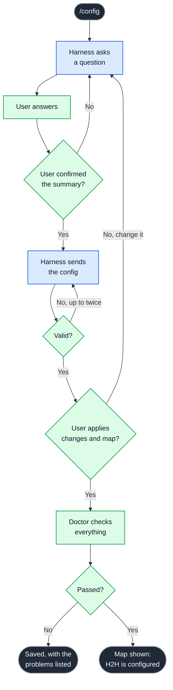

# Configuration: H2H

How a team is defined and changed.

## Principle

The team is declared as code, in the way Terraform declares infrastructure. The code is the single source of truth. The CLI and the UI are views onto it and both go through one API over one schema. If the UI kept its own settings, the two would drift and nobody would know which was in force.

## The file

The config is one TOML file, `h2h.toml`, at the root of the git repository H2H runs in, meant to be committed. Each project therefore has its own harnesses and domains. A project without one runs on the defaults H2H ships with. So far it declares the harness pool, the default harness and the domains of responsibility:

```toml
default_harness = "claude"

[harness.claude]
command = "claude"
args = []
ask_args = ["--permission-mode", "plan", "-p"]
version_args = ["--version"]
install_command = ["npm", "install", "-g", "@anthropic-ai/claude-code@latest"]
latest_command = ["npm", "view", "@anthropic-ai/claude-code", "version"]
trust_file = "~/.claude.json"
trust_key = ["projects", "{project}", "hasTrustDialogAccepted"]
trust_value = "true"
pass_env = ["ANTHROPIC_API_KEY", "CLAUDE_CODE_OAUTH_TOKEN"]
context_args = ["--append-system-prompt", "{roles}"]

[domain.ui]
harness = "claude"
does = "The web frontend"
paths = ["web/**"]
  [[domain.ui.subagent]]
  role = "coder"
  [[domain.ui.subagent]]
  role = "reviewer"

[domain.e2e]
harness = "copilot"
depends_on = ["ui", "backend"]
```

| Setting | Meaning |
|---|---|
| `default_harness` | The harness used when none is named, and the one that answers the console |
| `command`, `args` | How to start an interactive session |
| `ask_args` | How to get one non-interactive answer. The prompt is appended. A read-only mode is used where the harness has one |
| `permit_args` | Arguments added to a session so the harness asks H2H, through its own permission hook, instead of stopping at a prompt. `{permit}` is the program the hook runs. See [permissions.md](permissions.md#what-is-built) |
| `[permissions]` | What a harness may do without asking: `mode` (`ask` or `auto`), `allow` and `deny` patterns. See [permissions.md](permissions.md#the-rules) |
| `report_args` | Arguments added to a session so the harness may run `h2h-report`, the command it answers a delegated request with, without stopping to ask. They allow nothing else. See [runtime.md](runtime.md#delegating-to-a-running-harness) |
| `stream_args`, `stream_text`, `stream_when`, `stream_whole` | How to get that answer while it is being written. `stream_args` replace `ask_args` and make the harness print JSON, one object per line. `stream_text` says where the text is in a line, as keys joined by dots. `stream_when`, as `keys=value`, limits it to the lines that carry the answer. `stream_whole` says each piece is a whole message. See [runtime.md](runtime.md#streaming) |
| `conversation_args`, `resume_args`, `conversation_key` | How the default harness keeps one conversation going for each console session, so it remembers what was said before. Each list replaces `stream_args`, or `ask_args` for a harness that does not stream, for one answer: `conversation_args` start a conversation and `resume_args` continue it, with `{conversation}` standing for its ID. A harness that chooses its own ID has `conversation_key` instead of `conversation_args`: where its JSON output reports the ID, as keys joined by dots. A harness with none of them answers each message afresh. See [runtime.md](runtime.md#one-conversation-per-console-session) |
| `version_args` | Arguments that make the harness print its version and exit. `doctor` runs them to check that the program works; without them it only checks that the program is on PATH |
| `install_command`, `latest_command` | Whole commands, program first. The first installs the latest version of the harness or updates it, the second prints the latest version there is. `install` runs them, after the user chooses; see [runtime.md](runtime.md#install) |
| `trust_file`, `trust_key`, `trust_value` | Where the harness records that the user trusts a folder, read by `doctor`: a JSON or TOML file, the path of keys to the record, and what the record holds, or one entry of it if it is a list, when the folder is trusted. `{project}` is the project's path. H2H never writes this file; see [runtime.md](runtime.md#doctor) |
| `pass_env` | Environment variables the harness may see beyond the basic set. Names only; values stay in the environment |
| `context_args`, `context_env` | How a session started for a domain is told its role. In `context_args`, `{roles}` becomes the roles as XML. In `context_env`, `{roles_dir}` becomes a directory holding them as `AGENTS.md`. Each shipped harness has one; see [responsibility-map.md](responsibility-map.md) |
| `[domain.<name>]` | An area of responsibility. `harness` owns it, `does` says what it covers, `paths` are the files it owns |
| `[[domain.<name>.subagent]]` | A specialist role (`role`, `does`) the owner is asked to use inside the domain. Advice to the harness: H2H cannot see or enforce it |
| `depends_on` | Domains whose work this one waits for. A domain without it runs in parallel. Circles are rejected |

Unknown settings are rejected, so a typing mistake is reported instead of ignored.

### Changing it

| Way | What happens |
|---|---|
| `/config` | A conversation with the default harness, which asks how the team should be arranged and writes the file once the user says they are done |
| `/config --manual` | Opens a copy in the user's editor (`$VISUAL`, `$EDITOR`, then nano or vi). A project without a config starts from the one H2H ships with |
| Editing `h2h.toml` directly | Read the next time a command runs |

`/config show` prints the config as it stands.

The first two go through plan and apply: the result is validated, and nothing is written until the user confirms. What they are shown is the two things the question is about and nothing else:

1. **The lines that change** in `h2h.toml`.
2. **The map of the setup with this config,** last, so it is what stands right above the question. It is the same drawing as `/map`, with each domain's sub-agents listed in its box, because a box cannot be opened here to look inside.

The question sits under the map, which stays on screen and can be scrolled.

Answering no does not end the setup. In the conversation, the box opens again and asks what should be different, and the harness carries on from the config that was turned down; leaving it with Esc stops there. In `/config --manual`, H2H offers to open the editor again on the draft. A change applies to harness sessions started afterwards.

### The conversation

`/config` opens a box over the console page. It opens on a picture of the setup as it is now, so there is no description to read: the map, with each domain's owner and sub-agents in its box, and under it a table with one row per domain (owner, sub-agents, files, what it starts after). Under the picture it says how to reply.

The default harness then asks one question at a time. It does not explain H2H or list the setup again, because the picture has done that. The user answers in plain words, over several lines if they like, and can ask for a suggestion.

Finishing is not left to how the harness reads a "yes" or an "ok":

- **Typing `/done`** is read by H2H itself, which tells the harness in fixed words that the user is finished and to send the file.
- **The harness never asks for a confirmation in words** and never summarises the setup in prose. When the user is done it sends the file, and H2H asks: the changes, the map of the result, and a Yes or No.
- **A reply that does not say what to do,** such as a bare "yes" that answers no question, is not guessed at: the harness asks the user to either say what should change or type `/done`.



How it is built:

- **Each turn is one read-only run of the harness,** through its `ask_args`, given what H2H is for, the config as it stands, which harnesses are installed, and the conversation so far. The comments in the config are the schema the harness works from. It may read the project to suggest domains, and changes nothing.
- **It is not the harness's own interface in a box.** Showing that would need a terminal emulator inside the console. Running one turn at a time also makes the conversation work the same on every harness that has `ask_args`, and lets H2H tell exactly when the file has arrived: the harness puts a marker line before it.
- **A config that does not validate is sent back** to the harness with the reason, up to twice, and the user is told.
- **Leaving the box,** with Esc, cancels the setup and leaves the config as it was.
- **Without the console,** from the shell or a pipe, the same conversation is held as lines.

Each turn costs one answer from the default harness, and takes as long as that harness takes to start and reply.

## Why config as code

- **Reviewable.** The rules that limit a harness live in version control, with a history of who changed what and why.
- **Reproducible.** The same files set up the same team on another project or machine.
- **Improvable.** Lessons from rejections become config changes. A harness can propose a change to the rules as a pull request, which keeps a human gate on the rules themselves.

## Config and state

Declared config and runtime state are kept apart. A config file that fills up with status becomes unreviewable.

| Declared in config | Runtime state, not in config |
|---|---|
| The harness pool: how to start each harness, and which one owns which domain | Tickets and their status |
| Per-harness settings, where a harness must be treated differently: workspace kind, how trust is obtained, how hooks are delivered; see [runtime.md](runtime.md) | Which harnesses have passed the trust check |
| Permissions and credentials each owner may use, by reference | Proof attached to tickets |
| Permission rules per owner: what is allowed, denied, or asked; see [permissions.md](permissions.md) | Permission requests and the answers given |
| Budgets | Approvals and rejections |
| Approval rules by ticket type | Session history |
| What counts as proof for each kind of work | |
| How much checking each ticket type gets: self-check only, or with an independent tester, and which harness tests | Test reviews and the defects reported |
| Round limits and other guardrails | Running sessions, their workspaces and logs |
| The paths each domain owns | Usage per ticket: model, effort, tokens, rounds, outcome |
| Model and effort per domain and per phase of work | Estimates and actuals |
| Planning mode: kanban, or managed with a project manager | Sprints and retro reports |
| Sprint budgets | |

Secrets are never in the config. The config names a secret, and the value lives in a secret store or the environment.

The config is committed with the project, and the runtime state is kept out of it: H2H keeps that state in `.h2h/` and adds `/.h2h` to the project's `.gitignore` when the config is applied or a harness is started. See [runtime.md](runtime.md#state-directory).

## Plan and apply

A config change does not take effect directly. A plan step shows the difference first, for example "this gives the support owner write access to the deploy pipeline". Permission changes are the riskiest edits in the system, and the preview is cheap protection.

## Interfaces

| Interface | Audience | Best at |
|---|---|---|
| Config files | Anyone who wants the setup versioned and improving over time | Defining the team and its rules |
| CLI | Technical users, scripts, and harnesses themselves | Plan, apply, listing sessions, following logs, attaching to a session |
| UI, started with `h2h serve --port <n>` | Everyone, especially for approvals | The ticket board, the proof viewer, the side-by-side status view, a terminal for each session |

H2H is one binary. The CLI is the primary interface, and the UI is the same binary serving a web page, so there is nothing extra to install. The commands are listed in [runtime.md](runtime.md).

The UI matters most for the human approval side. It earns its place there before it does for editing config.

## Build order

1. **Schema.** The config format is the real design work and everything else depends on it.
2. **CLI.** Small to build and scriptable.
3. **UI.** The largest effort.

Beyond the harness pool, the config schema is not designed yet. See [roadmap.md](roadmap.md).
