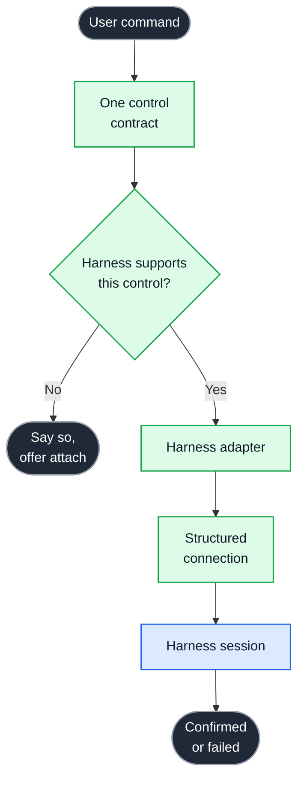

# Control: H2H

How the user runs every harness from H2H, with the same commands for each, without attaching to its terminal.

**Status: plan. Nothing in this document is built.** Only Codex has been tried against a running session, with a throwaway script; see [Codex results](#codex-results). What it says about the other harnesses comes from help output, protocol definitions and documentation, read on 2026-11-25.

## Goal

H2H orchestrates harnesses, so whatever the user must do to keep one working has to be possible from H2H. Attaching stays available, as a way to look closer and not as the only way to act.

Today H2H can start and stop a session, type a request into it, read its report, and tell that it waits for the user. It can answer a permission request only for Claude Code. It cannot see or change a running session's mode, model or effort, interrupt its current task, or answer a question it asks.

## The controls

| Control | What the user can do | Why orchestration needs it |
|---|---|---|
| Status | See whether it is working, idle or waiting, and its mode, model and effort | Nothing else can be decided without it |
| Send | Give it a request or a follow-up | Delegation. Built as `ask`, by typing |
| Answer | Answer a permission request, a question, or a plan waiting for approval | An unanswered one stalls the session |
| Interrupt | Stop the current task and keep the session | `stop` ends the whole session |
| Mode | Switch between planning and doing | A session can enter planning on its own and stay there |
| Model and effort | Change them for the next task | Cost control ([cost.md](cost.md)) |

New conversation, compacting and resuming are left for a later version of this plan.

## Rules

- **One command, every harness.** The user never needs to know how a product does it. Product differences stay in config, or in `internal/harness/<product>` where data cannot express them.
- **Gaps are declared and shown.** Each harness says which controls it supports. A command it cannot carry out says so and offers `attach`. It never pretends to have worked.
- **Confirmed, not assumed.** A change is reported as done only when the harness says so. A value H2H cannot read is shown as unknown.
- **No screen reading, no blind typing.** As in [permissions.md](permissions.md#what-h2h-does-not-do), H2H does not work out a prompt from the screen or answer it with keystrokes.
- **Control never loosens permissions.** Switching mode does not widen what `[permissions]` allows, and no control turns a harness's permission checks off.
- **The user decides.** The default harness may read status. It asks the user before it interrupts a session or changes its mode or model. It never answers a permission request or approves a plan. This keeps the limits in [governance.md](governance.md#limits-on-the-coordinator).

## The main decision: how H2H connects

A session today is a terminal. H2H can type into it and receive hooks from it. That is enough to send text and to learn some states, but most controls need a structured connection: messages with a meaning, and replies that confirm them.

| Approach | Control | Attach to the harness's own screen | Cost |
|---|---|---|---|
| A. Terminal and hooks | Only what hooks can answer. The rest would be typing keys without knowing what is on screen, which the rules forbid | Yes, as now | Small, and it cannot reach the goal alone unless hooks prove to cover far more |
| B. Protocol only | As much as the protocol offers | Not by default. H2H would have to draw the session itself | Large: a view of each session, and attach is lost or rebuilt |
| C. Shared server | As in B | Yes, if the harness's own screen can join the same session | Depends on each product supporting it |

**Proposed:** use C wherever it is shown to work. Where it does not, choose between A and B for that harness after the experiments below. All of them must sit behind the same commands.

Every command goes through one contract, and an adapter carries it to the product. A control a harness lacks ends in a clear answer instead of a guess.

## What each harness offers

These are leads to test, not support. "Listed" means it appears in the help output or the protocol definition of the installed version. It does not show that it works.

| | Claude Code 2.1.332 | Codex CLI 0.172.0 | Copilot CLI 1.0.116 | OpenCode 2.4.1 |
|---|---|---|---|---|
| Structured connection | Agent SDK; stream-json input | `app-server`, marked experimental | `--acp` (Agent Client Protocol) | `serve` (HTTP API), `acp` |
| Own screen joins it | Not found in the pages read | Listed: `--remote <address>` | Not found in the help | Listed: `--server <url>` |
| Interrupt | SDK `interrupt()` | `turn/interrupt` | ACP `session/cancel` | ACP `session/cancel`; HTTP not checked |
| Permission requests | SDK callback; `PermissionRequest` hook | `requestApproval` requests | ACP `session/request_permission` | HTTP API ([findings](permissions.md#per-harness)); ACP |
| Questions | SDK callback; `PreToolUse` hook on `AskUserQuestion` | `item/tool/requestUserInput` | `elicitation/create` (`copilot help acp`) | Not checked |
| Mode | SDK `setPermissionMode()` | Approval and sandbox policy on `turn/start`. No planning switch seen in the methods searched | ACP defines it. What Copilot offers was not checked. At launch: `--mode` | ACP defines it. Not checked. At launch for `run`: `--agent` |
| Model and effort | SDK `setModel()`; effort at launch, mid-session not confirmed | `model` and `effort` on `turn/start`; `model/list` | ACP config options. What Copilot offers was not checked. At launch: `--model`, `--reasoning-effort` | ACP config options. Not checked |

Sources: each CLI's `--help`; `copilot help acp`; `codex app-server generate-json-schema`, from which only method names matching this table's topics and the `turn/start` fields were read; the [Agent Client Protocol](https://agentclientprotocol.com/protocol/v1/prompt-turn) version 1 pages; and Claude Code's documentation on [permissions](https://code.claude.com/docs/en/agent-sdk/permissions), [user input](https://code.claude.com/docs/en/agent-sdk/user-input), [interrupting](https://code.claude.com/docs/en/agent-sdk/streaming-vs-single-mode) and [hooks](https://code.claude.com/docs/en/hooks). What a protocol defines is not proof that a product implements it.

Claude Code needs the most care:

- **No Go SDK was found.** The pages read describe the Python and TypeScript SDKs. They did not describe the control messages of stream-json input, which H2H would need in order to speak to the CLI directly.
- **Login.** Anthropic's [SDK documentation](https://code.claude.com/docs/en/agent-sdk/overview) limits what third-party products may do with claude.ai logins. This must be settled against "bring your own login" ([authentication.md](authentication.md)) before building on the SDK.
- **Hooks may cover part of it.** The hooks page appears to let a `PermissionRequest` answer set the permission mode. This came from a summary of a long page, so check it. A hook acts only when it fires, so it cannot switch mode or interrupt at any moment the user chooses.

## Codex results

The experiments passed for Codex 0.172.0 with one important condition. The details and limits are in [findings.md](findings.md#later-check-controlling-a-codex-session).

- **Approach C works.** H2H and Codex's own screen shared one session through its app server.
- **H2H must create the session.** The screen then joins it. Joining a session the screen had created did not work in this test.
- **The controls tried worked:** status, send, interrupt, answering approvals and questions, mode (including ending a plan mode started on the screen), and model and effort. One of the question runs did not produce a question, for a reason not captured.
- **Roles and a hook go to the server.** Given to it with `-c`, both worked. Since roles differ between sessions, this points to one server per session.
- **Still to do:** the rest of experiment 6, restarting and reconnecting, and a decision on depending on an experimental interface.

Grok was added as a built-in harness after this comparison, and its control connections have not been compared. Its help lists `grok agent`, and its documentation an Agent Client Protocol interface.

## Where it lives

The connection must survive the console closing, as sessions do today. The keeper is deliberately small: it holds a terminal, serves attach and writes state ([runtime.md](runtime.md#keeper)). Speaking a protocol does not belong in it by default. The likely shape is a control process per session beside the keeper. This is decided after the experiments, with the least-privilege rule: it gets that session's connection and nothing else, reachable only by the same OS user. A harness server that listens on the network must be bound to this machine and require a token.

## Experiments first

Each harness gets the same questions, in a scratch project. They use the user's allowance.

1. **Join.** Start a session so that H2H and the harness's own screen are connected to it at once. Does each see what the other does?
2. **Interrupt.** Stop a long task. Does the session accept the next request?
3. **Answer.** Trigger a permission request and a question. Answer both from outside. What happens if the screen answers first?
4. **Mode.** Have the harness enter planning, see that from outside, and bring it out. This is the case that left the user stuck.
5. **Model and effort.** Change both mid-session and confirm what the next task used.
6. **Keep what works.** With that connection, do roles, state hooks, `h2h-report`, trust and the user's own login still work?

Results go in [findings.md](findings.md) with the version and level reached for each harness. OpenCode's free usage limit was reached on 2026-11-25, so its experiments need a working provider.

## Build order

| Step | What is built | Done when |
|---|---|---|
| 0 | The experiments | The connection approach is chosen for each harness, and this document is updated |
| 1 | The control contract, declared support per harness, and status | `ps` shows state and mode, or unknown, for every harness |
| 2 | Interrupt and answer | A session can be unblocked without attaching, wherever the experiments showed it can |
| 3 | Mode | A session in planning can be brought out from H2H |
| 4 | Model and effort | A change is confirmed by the harness |

Each step covers all four harnesses or records the gap, as the harness-parity rule requires. This extends stage 3 of the [roadmap](roadmap.md#stages), the harness adapter, and comes before the build and test loop, which assumes sessions that can run without a person attached.

Command names, such as `/interrupt <id>`, `/answer <id>`, `/mode <id>` and `/model <id>`, are placeholders until step 1.

## Open questions

- If a harness cannot be both controlled and attached to, which matters more for that harness?
- Which words does H2H use for modes? Products differ, and a planning mode is separate from the `ask` and `auto` modes of `[permissions]`.
- What happens to a request when H2H and the harness's own screen could both answer it?
- Is an experimental interface, such as Codex's `app-server`, acceptable to depend on, and what happens when it changes?
