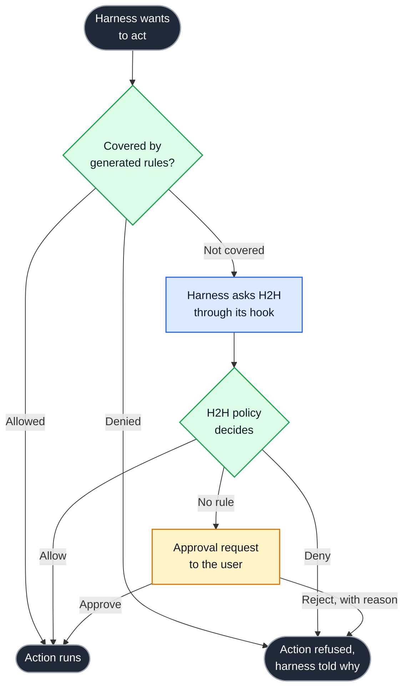

# Permissions: H2H

How H2H answers a harness that stops and asks "may I do this?", so the user does not have to be attached to every session.

## The problem

Every harness asks before it runs a command, edits a file or reaches a URL that its rules do not already allow. In a terminal the user answers. In H2H nobody is watching most sessions, so an unanswered prompt stalls the session and its ticket.

The user's answer is usually predictable: "yes to running the tests", "never push to main". H2H takes those answers once, as config, and applies them on the user's behalf. Anything the config does not cover still goes to the user.

This is separate from who may grant permissions, which is covered in [governance.md](governance.md), and from logins, which are covered in [authentication.md](authentication.md).

## How a request is answered



Most requests are settled by rules the harness enforces itself, and the rest are decided by H2H policy in code. Only a request that no rule covers reaches the user, as an approval request with the same approve or reject flow as a ticket.

## Three layers

### 1. Generated native rules

Each harness has its own permission settings: allow and deny lists for commands, file paths and URLs. H2H writes them from its config when it starts a session.

- **Why first:** the harness enforces these itself, with no round trip to H2H, and they hold even if H2H is down.
- **Limit:** each harness has its own rule syntax and its own gaps, so the H2H config can only express what can be translated for every harness in the pool.

### 2. Policy decisions through a hook

A request that the native rules do not settle is sent to H2H by the harness's own extension point: a hook that runs before a tool is used, or a tool the harness calls to ask for permission. H2H answers allow or deny from its policy, in code, with no model call.

- **Why:** policy can use what only H2H knows, such as the ticket, the domain's paths, the budget left and the risk level of the ticket type.
- **Limit:** depends on each harness having such an extension point. Claude Code, Copilot CLI and Codex CLI all have one; see [Validation](#validation).

### 3. Escalation to the user

A request with no matching rule becomes an approval request. The session waits, the user is notified, and the answer is recorded on the ticket. An answer can be saved as a new rule, so the same question is not asked twice.

## What H2H does not do

H2H does not answer a prompt by typing "y" into the harness's terminal. That would mean reading the screen to know what is being asked, and a misread approves the wrong action. If a harness offers no way to answer in code, its prompts go to the user by attach, and that harness is a poor fit for unattended work.

## What the config declares

Per domain owner, and optionally per ticket type:

| Declared | Example |
|---|---|
| Commands allowed without asking | Run the test suite, read-only git commands |
| Commands always denied | Push to the main branch, delete outside the workspace |
| Paths that may be written | The paths the domain owns |
| URLs that may be reached | The package registry, the project's staging site |
| What happens when no rule matches | Ask the user (default), or deny |

Deny wins over allow. A change to these rules goes through plan and apply like any other config change; see [configuration.md](configuration.md).

## Containment

Automatic approval raises the cost of a wrong rule, so each session also needs a boundary that does not depend on the rules being right:

- **Workspace.** Each session already has its own working copy. That separates files inside the project only.
- **Sandbox.** The session should also be unable to reach the rest of the machine: the home directory, other projects, other sessions' credentials. A container or an operating system sandbox per session is the candidate. Not designed.
- **Network.** Reaching only the declared URLs, enforced outside the harness. Not designed.

The broader the automatic approvals, the stronger the containment has to be. A session with no sandbox should run with narrow rules and ask often.

## What is built

Layers 2 and 3, for the shell and the other tools a harness asks about, with rules for the whole project. Layer 1, rules per domain, saving an answer as a rule, and containment are not built.

### The rules

They are the `[permissions]` table of `h2h.toml`:

```toml
[permissions]
mode = "ask"
allow = ["git status*", "git diff*", "npm test*"]
deny = ["git push*", "*rm -rf*"]
```

| Setting | Meaning |
|---|---|
| `mode` | What happens to a request no rule covers. `ask`, the default, puts it to the user. `auto` allows it |
| `allow` | Patterns for what runs without asking |
| `deny` | Patterns for what is always refused, in `auto` mode too. Deny wins over allow |

A pattern is matched against a shell command as it would be run, or for another tool its name followed by what it acts on, such as `Edit web/app.tsx`. A `*` stands for any text, and a pattern without one matches only that exact text.

Paths in a request are rewritten before the rules are applied, so that a config committed with the project works wherever the project is cloned:

| Where the path points | Written as | Example rule |
|---|---|---|
| Inside the harness's own working copy of the project | `./` and the path from its top | `Edit ./web/*` |
| Inside the project's folder, outside that working copy | `{project}` and the path from the project's top | `git -C {project} status*` |
| Anywhere else | In full | `Edit /etc/hosts` |

A harness works in its own working copy, so `./` is where its edits belong, and a rule such as `Edit ./*` allows them without allowing edits to the main checkout or to anything outside the project. The dialog shows the command as the harness wrote it, with its real paths.

A shell command line is often several commands: `git status --short | head; git log -1`. The rules are applied to each command in it, split at `;`, `&&`, `||`, `|`, `&` and line breaks outside quotes:

- **Denied** if any command in it matches a deny pattern, or the line as a whole does. `git status && git push` is denied by `git push*`.
- **Allowed by rule** only if every command in it matches an allow pattern. `git status*` therefore does not let `git status; make deploy` through: that goes to the user.
- **Never allowed by a pattern** if a command writes to or reads from a file with `>` or `<`, or runs another command inside itself with `$( )` or backticks. It does more than its pattern says, so it goes to the user. Sending output to `/dev/null` and joining the output streams with `2>&1` do not count.

`auto` is the option for running unattended. It makes the deny list the only thing between a harness and the machine, so it belongs with a short allow list of nothing and a deny list of what must never happen, and it is the user's choice to make per project.

### How a request travels

A harness started with `permit_args` has its permission hook pointed at `h2h-permit`, a small program in the session's state directory. When the harness is about to stop and ask, it runs the hook instead:

1. `h2h-permit` reads the request and matches it against the rules. An allow or a deny is answered at once, with no prompt anywhere.
2. With no rule, the request is put in the session's queue and the hook waits.
3. The H2H console looks at the queues every two seconds and shows the oldest request as a dialog: which harness, what it wants to run, and three answers. **Allow once**; **allow this for the rest of that harness's session**, which is remembered until the harness is removed; or **deny**.
4. The answer goes back through the hook. A deny carries a message that tells the model what to do next: not to try another way, to carry on with the rest, and to say so in its report.

The dialog opens with the focus on Deny, and leaving it with Esc also denies: a question that appears while the user is typing must not be answered yes by their next Enter. While the user is attached to a harness the console cannot show a dialog, so a request waits until they are back.

A request waits nine minutes, just under the ten a harness gives its hook. If nobody answers, which includes the console not being open, the harness is told the request is still waiting and to carry on without it. Holding a request for hours is not built.

One thing needs no rule: the harness sending its report with `h2h-report`, which is what H2H asked it to do. It is let through only when the command is that and nothing else; a report command with another command attached is treated like any other request.

When H2H cannot judge a request, it never allows it: a request it cannot read, or a config it cannot load, goes to the user. If the hook program itself fails, the harness falls back to its own prompt in its terminal, which is what would have happened without H2H.

### Per harness

| Harness | How its hook is pointed at H2H | Checked on | Level reached |
|---|---|---|---|
| Claude Code | `permit_args = ["--settings", '{"hooks":{"PermissionRequest":[...{permit}..."timeout":600...]}}']`, a settings source added for the session, beside the user's own. The time limit is stated because the hook otherwise gives up before a person has answered, and the prompt appears after all | 2.1.331 | Behaves: in a session started in manual mode, a command with no rule reached H2H's queue; allowed after a 75-second wait it ran, denied it did not run and the report said the user declined; no prompt appeared in its terminal either time |
| Codex CLI | Not wired. It takes the same hook and the same answer, as a config override, but asks the user to review each new hook unless started with a flag that skips the review. Which of the two H2H should do is the user's decision, and the check that would settle the details was not run | 0.172.0 | None |
| Copilot CLI | Not wired. It reads hooks only from files in its user folder, so this needs an install the user approves; see [runtime.md](runtime.md) | 1.0.114 | None |
| OpenCode | Not wired. It has no hook that runs a program: a permission request goes to the client attached to its server, which answers once, always or reject over its HTTP API. Wiring it needs code that talks to that API. Its own default allows everything except reading `.env` files, so a session does not stop to ask | 2.4.1 | None |
| Grok | Not wired. It has permission rules and a `PreToolUse` hook, but no way was found to give a hook to a session at launch. A session follows the user's own permission setting, which may approve everything | 1.0.92 | None |

A harness that is not wired behaves as it does on its own: it stops at a prompt in its terminal, and the user answers by attaching. `h2h start` says so when it starts one. The user is no longer left to find that out: H2H marks such a session "waiting for you" and says so in the console the moment the harness's own hooks report the prompt, which Copilot and Codex now do, or "may be waiting for you" once a session with a request open has been silent for 20 seconds, which covers OpenCode; see [runtime.md](runtime.md#waiting-for-you).

Wiring Copilot and Codex to this queue as well is still open. Copilot's permission hook fires before every tool call, including those its own rules allow, so H2H would have to allow what Copilot allows by itself, or every read would ask. Copilot's hooks no longer need an install in its user folder, though: it loads them from a plugin folder given with `--plugin-dir`, as the waiting hooks do. For Codex the review flag is now in use for the waiting hooks, so what remains is sharing its one `PermissionRequest` hook between H2H's answer and the waiting signal, and checking a held request end to end.

## Validation

Layers 2 and 3 were tested on Claude Code, Copilot CLI and Codex CLI; the details are in [findings.md](findings.md).

| Tested | Result |
|---|---|
| A hook answers "allow" and the action runs with no prompt | Works on all three |
| A hook answers "deny" with a message, and the model acts on the message | Works on all three |
| A request with no rule waits for the user's answer, then runs or is refused | Works on all three, for a five-second wait |

What the tests showed about each harness:

| Harness | Permission hook | Note |
|---|---|---|
| Claude Code | `PermissionRequest`, only when it is about to ask | Hooks can be passed on the command line |
| Copilot CLI | `permissionRequest`, on every tool call | The policy is consulted even for actions its own rules allow |
| Codex CLI | `PermissionRequest`, only when the model asks to leave the sandbox | Enforces by sandbox. Its instructions must say to request approval when the sandbox blocks a command, or the model reports the failure and stops |
| OpenCode | None that runs a program; requests are answered by a client over its HTTP API | Allows every action by default, so the H2H rules are not consulted |

Consequences for the design:

- **Waiting for permission is H2H's own state.** With the hook in place, a harness never shows a prompt. The wait is a request in H2H's queue.
- **Each adapter writes standing instructions** for its harness: follow instructions in a refusal, and for Codex, ask for approval when blocked.
- **Deny messages are instructions.** They should state the next step plainly, because the model does what the message says.

## Not verified

- **A long wait.** Hooks have time limits: 600 seconds by default on Claude Code and Codex, 30 on Copilot. A person may take hours. The likely design is to deny with "waiting for approval", park the ticket, and resume the session when the answer arrives.
- **Generated native rules** (layer 1), and how they combine with the hook.
- **Tools other than the shell:** file edits, web access and MCP tools.
- **Sub-agents** started by a harness, and non-interactive mode.
- **A hook that fails.** The harnesses differ on whether that allows or denies.
- **Containment.** An approved Codex command runs outside its sandbox, and nothing here limits what an approved action can reach.
