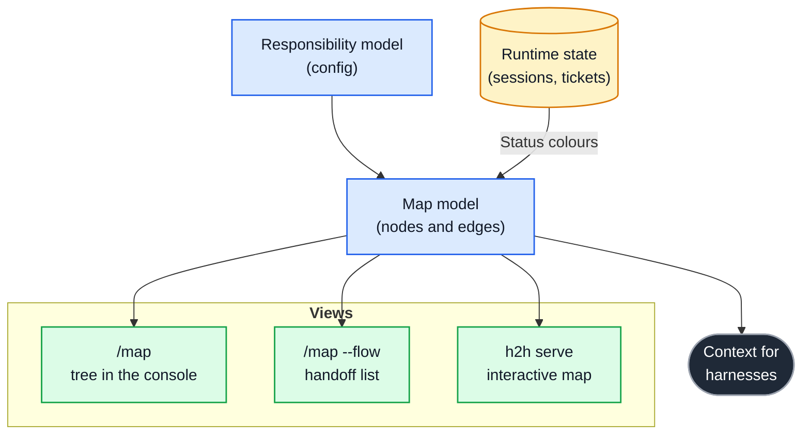

# Responsibility map: H2H

**Status: proposal.** The first slice is built: `/map` draws the config as it exists today (harnesses, how each starts, what it may see, its sessions) and the same map is given to the default harness as context. Domains, paths and sub-agent roles are not in the config schema yet.

How the user declares who owns what, including the roles of each harness's sub-agents, and how H2H shows that as a map of ownership and work flow.

## The idea

H2H already holds each harness's configuration. This note extends it with a **responsibility model**: for every harness, its domain, the paths it owns, and the roles its sub-agents play inside that domain. H2H uses the model in two ways:

- **As context.** When the user talks to H2H, the default harness that answers free text receives the model, so it can answer "who owns checkout?" or route a request to the right owner. Each owner receives its own slice at session start.
- **As a picture.** The same model is drawn as a map, so the user sees who owns what and how work moves between owners.

## One model, three views



The structure of the map comes only from config, and only the colours come from runtime state. Every view and the context given to harnesses are built from one map model, so they cannot disagree.

## What is declared

A sketch in TOML, the format currently favoured. The config schema is not designed yet, so names are illustrative.

```toml
[[harness]]
name   = "builder"
uses   = "claude"
domain = "Web UI"
paths  = ["web/**"]

  [[harness.subagent]]
  role = "component author"
  does = "Writes React components to the design system"

  [[harness.subagent]]
  role = "a11y reviewer"
  does = "Checks every change for accessibility"

[[harness]]
name   = "tester"
uses   = "copilot"
domain = "UI testing"
tests  = ["builder"]
```

**Flow is derived, not drawn.** Edges such as builder to tester to human come from rules the config already has: who tests which owner, and which ticket types need human approval ([governance.md](governance.md)). Declaring the same handoffs again would give two sources for one fact.

## The views

| View | What it shows | How |
|---|---|---|
| `/map` in the console, `h2h map` in scripts | H2H at the root, then each harness, its domain and paths, then its sub-agent roles, with a status icon per harness | An indented tree |
| `/map --flow` | Who hands work to whom: builder to tester, tester to human, and which ticket types skip a step | One line per edge, grouped by owner. Optionally `--mermaid`, which prints Mermaid text for GitHub or a browser |
| `h2h serve` | The full mindmap: ownership radiating from H2H, handoffs as arrows, live status colours, click a node to open its session or pending approval | An interactive graph in the browser |

A terminal cannot draw a true mindmap. A tree covers "who owns what", which is most of what the user asks, and the web view carries the rest.

## Libraries

All checked against [licensing.md](licensing.md) on 2026-11-23.

| Library | Use | Licence | Verdict |
|---|---|---|---|
| Lip Gloss (`charm.land/lipgloss/v2`, v2.1.1), its `tree` package | Console tree, colours and icons | MIT. Its dependencies are MIT, plus BSD for `golang.org/x/sys` | **Fits, and used.** The console already depends on Lip Gloss v1.1.0, whose `tree` package `/map` uses, so it adds no dependency |
| mermaid-ascii (Go) | ASCII flowcharts in the console | MIT | **Do not adopt.** It has no tagged releases, only pseudo-versions; it has one maintainer; and its module brings in gin, sonic, cobra and protobuf. That fails "maintained and widely used" and needs an awkward audit. Flow as a list of edges is simpler and stays readable past 10 nodes |
| Cytoscape.js (v3.35.0) | Web map | MIT, with no runtime dependencies | **Recommended** for `h2h serve`. Layouts such as `cose-bilkent` and `fcose` (both MIT) give a mindmap look, and it handles live restyling and clicks |
| Mermaid.js (v12.3.0) | Web map | MIT itself, but it now depends directly on `elkjs` (EPL-2.0 or GPL-3.0). `dompurify` is MPL-2.0 or Apache-2.0, so Apache-2.0 applies | **Do not embed.** Embedded files count under the licence rules, and `elkjs` is not on the allowed list. Emitting Mermaid *text* for the user to render elsewhere is fine, because nothing is shipped |

## Fit with the existing design

- **Config as code** ([configuration.md](configuration.md)). The model is declared config, edited through plan and apply, and kept apart from runtime state. This fits as is.
- **Harness as opaque** ([design.md](design.md)). H2H does not run or see a harness's sub-agents. Declared sub-agent roles are **advice passed as context, not enforced**, and the map must show them as declared, not observed. This is the main tension in the note.
- **Sub-agent visibility** is already an open question in [roadmap.md](roadmap.md). The map does not settle it. A sub-agent node can show live status only where a harness's hooks report sub-agents, and that has not been checked for all three products.
- **One behaviour for every harness** ([runtime.md](runtime.md)). Turning roles into a harness's native sub-agent definitions differs per product. That belongs in each adapter. Plain context in the prompt is the common fallback. Any definition files must follow the rule that H2H does not write into the workspace.
- **Console and default harness** ([runtime.md](runtime.md)). `/map` is a slash command that prints a snapshot into the transcript, and `h2h map` does the same from the shell. The default harness that answers free text is the main consumer of the model as context.
- **Governance.** A coordinator harness may propose changes to the model, as for any config, and a human applies them. This needs no new rule.
- **Roadmap.** The console tree needs the config schema (stage 7) or an earlier slice of it. The web map belongs to the web UI (stage 9). Context injection depends on "standing instructions", which is still open.

## Open questions

- **Advice or contract?** If a harness ignores its declared sub-agent roles, is that a defect, or only a hint that was not followed? H2H cannot tell from outside without sub-agent hooks.
- **Native sub-agent definitions.** Which harnesses accept sub-agent definitions at launch without files in the workspace? Claude Code is believed to accept them as a launch flag. Copilot and Codex are unverified.
- **Context cost.** Giving the full model to every free-text answer costs tokens on each turn. Possibly only a summary plus the slice that matches the question should be sent.
- **One map or two.** Should ownership and flow share one web view with a toggle, or be separate views? The tree and the flow have different shapes.
- **Shared paths.** How a node shows a path that two domains touch, such as a dependency manifest. This is tied to the open "path ownership" question.
