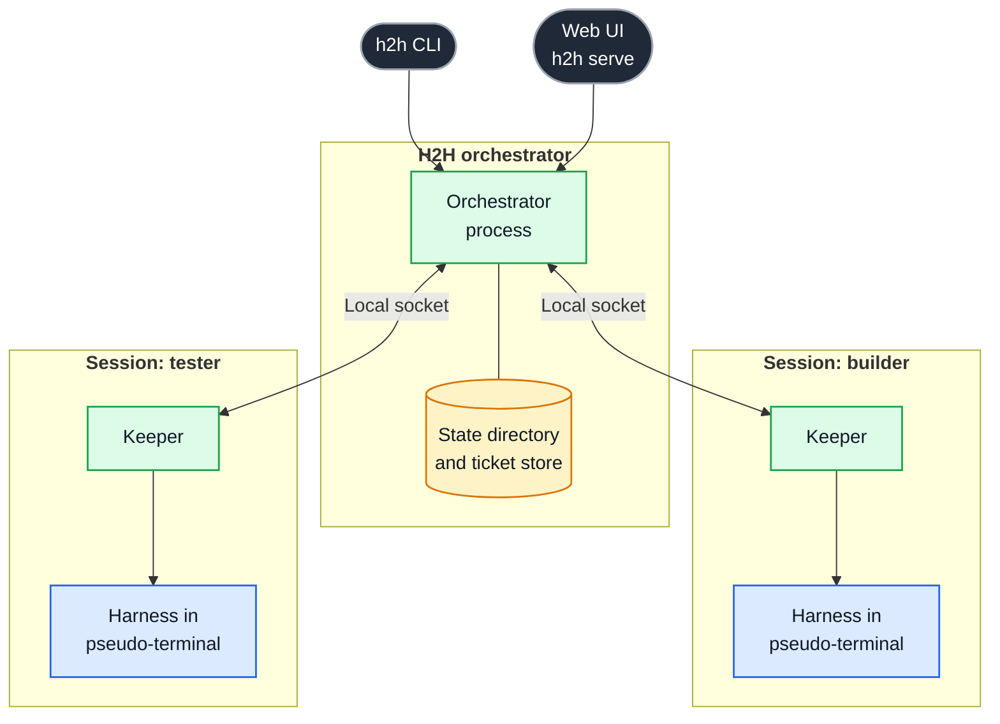
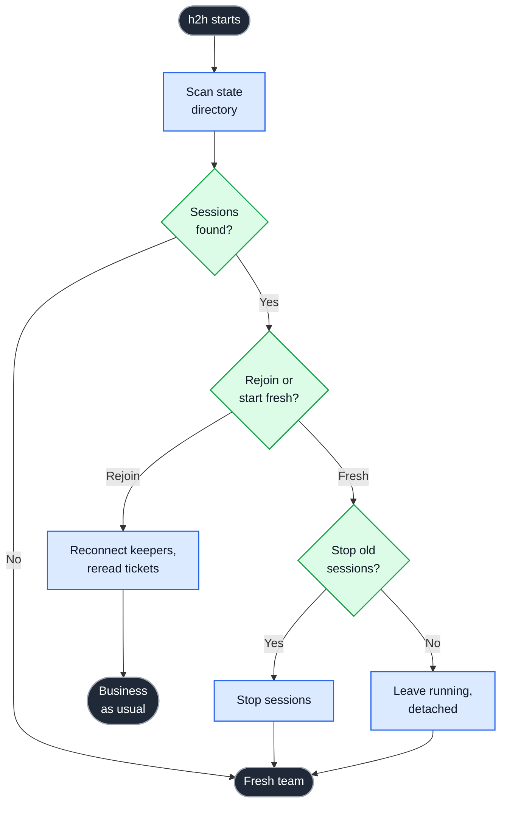
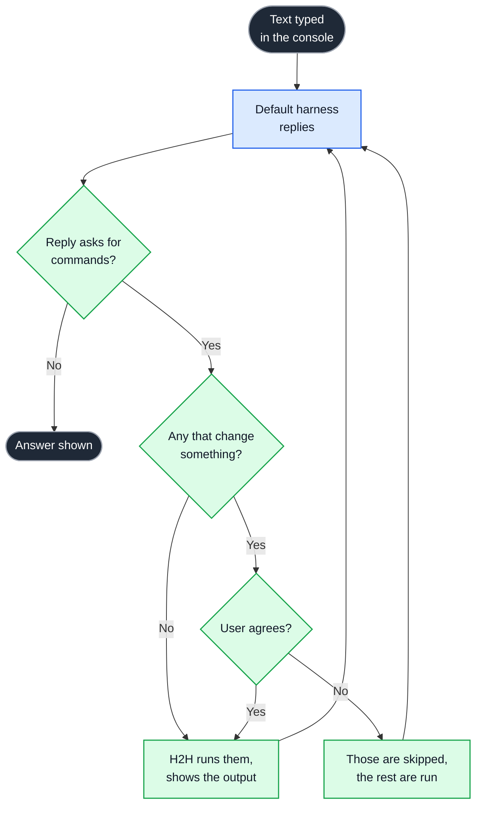

# Runtime: H2H

How H2H runs harnesses as processes: sessions, workspaces, monitoring, jumping in, and surviving a crash.

## Role

H2H is a harness supervisor as well as a coordinator. It starts each harness, gives it a workspace, tracks its session, keeps its logs, and lets the user watch or step into it. The closest comparisons are tmux for the sessions and Docker for the listing, logs and "open a terminal inside it" experience.

## Process model

Each harness runs under its own keeper process, which is independent of the orchestrator and records its state on disk. The orchestrator talks to keepers over local sockets, so it can stop and start again without disturbing a running harness.

### Orchestrator

The process that applies the rules: it assigns tickets, enforces approvals and budgets, and serves the CLI and the web UI. It holds no state that exists only in memory. Everything it needs is in the state directory and the ticket store.

### Keeper

A small process that sits between H2H and one harness. Docker calls the equivalent a shim.

- **Owns the harness.** It holds the pseudo-terminal and the harness process. It is detached from the orchestrator, so an orchestrator crash does not affect it.
- **Records state on disk.** Session ID, workspace path, ticket, status, exit code and the terminal log.
- **Offers a socket for attaching** to the terminal.
- **Stays tiny.** If a keeper dies, its harness dies with it, so the keeper does nothing beyond holding the terminal and writing state.

The keeper is the `h2h` binary started in an internal mode, so there is still only one file to ship.

### State directory

One entry per session, written by its keeper, plus the ticket store (for example SQLite). Because listing, logs and attaching read from here and from the keepers' sockets, they keep working even when the orchestrator is not running.

The state directory is `.h2h/` at the project root. Everything H2H keeps while it runs is in it: sessions and their logs, the workspaces, saved console sessions, permission requests and the session counters. Only two things H2H writes are outside it: `h2h.toml`, the config, which is meant to be committed, and `h2h.toml.<pid>.tmp`, which the config is written to before it replaces `h2h.toml` and which is left behind only if H2H stops in between.

So that none of this ends up in the project, H2H adds `/.h2h` and `/h2h.toml.*.tmp` to the project's `.gitignore` whenever the config is applied and whenever a harness is started, and says so the first time. It creates the file if there is none and otherwise only appends, under a comment line starting `# H2H`, leaving the lines already there as they are. It skips a line the file already has, and a path git already ignores by another rule, such as a broader pattern or the user's global excludes file. It never stages or commits. The state directory also carries a `.gitignore` of its own that ignores everything in it, which keeps it out of git even if the project's lines are removed; H2H puts them back at the next start.

## Sessions and workspaces

- **Session.** One running harness with its own history. H2H records the harness's own session ID so the session can be resumed later.
- **Workspace.** Each session gets its own working copy, for example a git worktree, so two sessions never edit the same files. H2H creates it when the session starts and removes or archives it when the session ends.
- **Trusted workspace.** A harness asks before working in a folder it has not been told to trust, and an unanswered question stalls the session before it starts. See [Workspace trust](#workspace-trust).
- **The same harness twice.** Two sessions of one product are two keepers with separate workspaces and histories.

## Workspace trust

The first time a harness runs in a folder, it asks the user whether to trust it and records the answer. H2H creates a new workspace for every session, so without a plan every session would stop at that question.

### One behaviour for every harness

A session behaves the same whichever harness runs in it: the same kind of workspace, the same way of getting trust, the same way of getting hooks. Where a harness cannot do what the others do, H2H looks for a different mechanism that gives the same result before it accepts a difference. A difference that remains is declared in the config per harness, never hidden in code.

### How each harness handles trust

| | Claude Code | Copilot CLI | Codex CLI |
|---|---|---|---|
| Trust is attached to | The git repository root. A worktree counts as its main checkout. A nested repository is separate | A folder | A project folder |
| Covers subfolders | Yes, except nested repositories | Yes | Yes for a subfolder of a trusted repository (observed) |
| Recorded in | `~/.claude.json`, per project path | `trustedFolders` in `~/.copilot/config.json` | `trust_level` per project in `~/.codex/config.toml` |
| Supported way to grant it without the dialog | None for interactive sessions | `--trust-folder`, for one non-interactive run only | `codex exec --trust`, which saves it (not tested) |
| Without a terminal (`-p`, `exec`) | No dialog is shown | Skips the folder's hooks and MCP servers unless `--trust-folder` is given | Not tested |

Sources: each harness's documentation and help text, and the validation spikes. A per-launch config override did not remove Codex's dialog when tested.

### The workspace model

Every session, for every harness, gets a git worktree of the project, kept in one folder inside the project such as `.h2h/workspaces/`. Tested with all three:

| In a worktree of the project | Claude Code | Copilot CLI | Codex CLI |
|---|---|---|---|
| Starts without a trust dialog, when the project is already trusted | Yes | Expected from its subfolder rule. Not confirmed, because the test project was not trusted in Copilot | Yes |
| Hooks given at launch, with no file in the workspace | Yes, with `--settings` | No | Yes, as config overrides |
| Hooks from the harness's user folder, with no file in the workspace | Not needed | Yes, from `~/.copilot/hooks/` (3 of 3 runs) | Not needed |
| Hooks read from a file in the worktree | Works, but triggers the trust dialog | Yes, from `.github/hooks/` | No. The file was ignored |
| Completed the test task with state reported throughout | Yes | Yes | Yes |

So the worktree model holds for all three, and trust and hooks are handled as follows.

**Trust: inherit what the user has already given.** Because workspaces sit inside the project, a project the user has trusted in a harness covers them. H2H gives no consent on the user's behalf. Where a harness does not yet trust the project, `h2h` checks before starting any session and tells the user, who consents once through the harness's own dialog or documented command.

**Hooks: never written into the workspace.** Claude Code and Codex take hooks as launch arguments. Copilot reads hooks only from files, so for Copilot H2H installs its hooks once in Copilot's user folder (`~/.copilot/hooks/`), which applies to every folder:

- **Installed with consent.** The install is a setup step the user approves, because it changes their own Copilot setup. H2H shows what it will add first, and removes it again on uninstall.
- **Inactive outside H2H.** The hooks do nothing unless the session was started by H2H, which they tell from an environment variable H2H sets. The user's ordinary Copilot sessions are unaffected.
- **One file, owned by H2H.** H2H adds its own file and does not edit hooks the user already has.

This was tested: with the hooks only in Copilot's user folder and nothing from the keeper in the worktree, Copilot reported every state and passed the full scenario, and the same hook command run without H2H's environment variable did nothing. See [findings.md](findings.md).

The result is the same for all three harnesses: a workspace holds the project's files and nothing from H2H. The alternative, a hooks file in each worktree kept out of git, was set aside because it puts H2H's files into every workspace and has to be cleaned up per session.

This is an install of hooks, not of trust. H2H does not write trust into a harness's own config files. Claude Code documents its trust entry only as something a person may edit by hand, and a tool writing to a file the harness also writes can corrupt it.

Rules that follow:

- **No fresh repository per session.** A new `git init` is its own trust root in Claude Code, and asked every time in the spikes.
- **Trust is not permission.** Trusting a workspace lets the harness load its settings. What the harness may then do is decided by [permissions.md](permissions.md).

### Per-harness settings in the config

Where harnesses still differ, the user's config says how H2H treats each one. The defaults are the same for all, and an entry is only needed to depart from them:

| Setting | Default | Example of a departure |
|---|---|---|
| Workspace kind | Worktree inside the project | A plain subfolder, for a harness that mishandles worktrees |
| How trust is obtained | Inherited from the project | Ask the user at first start |
| How hooks are delivered | At launch, or from the harness's user folder where it has no launch option (Copilot) | A file in the workspace, for a harness that offers neither |
| Extra launch arguments | None | A sandbox mode for Codex |

The schema is not designed; see [configuration.md](configuration.md).

### Not settled

- **Copilot trust in a worktree.** Expected to follow its documented subfolder rule, and to be confirmed in a project Copilot already trusts.
- **A project the user never opened in a harness.** The first run then needs the user present, once per harness.
- **Trust scope.** Trusting the project also trusts whatever settings the repository carries, for every session. That is the user's existing decision, but H2H makes it apply to unattended runs.
- **Codex's hook review.** Codex wants each hook reviewed by the user. The spikes skipped that with a flag meant for automation. Whether H2H should use that flag or have the user review H2H's hooks once is open.

## Landing work

A harness works in its workspace, so what it builds is not in the project until it is brought there. `h2h land [id]` does that, for any harness, with git alone:

1. **Where to.** The target is the branch checked out in the project root. With no branch checked out, or a merge or rebase unfinished there, landing refuses and says why.
2. **What there is.** H2H looks for commits in the workspace that the branch lacks, and for uncommitted and untracked files. With neither, it says there is nothing to land.
3. **A running harness.** It may be in the middle of a change, so H2H asks before taking what it has so far.
4. **Uncommitted work.** Only commits can be landed. H2H lists what is uncommitted and asks whether to commit it in the workspace, in one commit named after the harness. Declining stops there. Files that git ignores are never committed.
5. **The plan.** H2H shows the target branch, the number of commits, the files they change, and whether it is a fast-forward or needs a merge commit, and asks. Nothing in the project has changed up to this point.
6. **The landing.** The workspace's commit is merged by its hash: a fast-forward when the branch has not moved, a merge commit otherwise. This works the same when the harness stayed on the detached HEAD it started on and when it made a branch of its own, and it leaves no branch behind.

If the merge conflicts, H2H undoes it, so the project is as it was, and the conflict is for the harness to settle in its workspace. If files in the project that are changed or untracked would be overwritten, git refuses before it touches anything, and H2H passes on what it said.

Landing does not push, stop the harness or remove its workspace. Removing a harness (`h2h rm`) asks first when its workspace holds work that exists nowhere else: uncommitted changes, or commits on no branch that were never landed.

What this is not: the merge queue of [governance.md](governance.md), which re-runs the declared checks before merging and is not built. Landing is the user's own decision, one harness at a time.

## How H2H and a harness communicate

Reading a harness's status off its terminal screen is fragile, so H2H never does that. The harness tells H2H instead, in two ways.

| Direction | Channel |
|---|---|
| Work into the harness | The prompt when the session starts, and text typed into its terminal |
| State out of the harness | The harness's own hooks: session started, prompt accepted, tool started and finished, permission needed, turn finished, session ended. H2H configures them when it starts the session |
| Content out of the harness | A reporting tool that H2H provides, as an `h2h` command or an MCP server. The harness calls it to say "ticket done, here is the proof" or "blocked, need a decision" |
| People | The terminal, for watching and jumping in |

Hooks fire whether or not the model remembers to report, so they carry the state. The reporting tool carries what only the model knows. The validation spikes confirmed both on Claude Code, Copilot CLI and Codex CLI; see [findings.md](findings.md).

The requirement for a harness to join a team is: it runs in a terminal, it has lifecycle hooks, and it can call a tool.

### Session states

| State | Decided by |
|---|---|
| Working | A prompt or tool event from the harness's hooks |
| Waiting for a permission answer | A permission request held by H2H; see [permissions.md](permissions.md) |
| Idle | The turn-finished hook |
| Hung | No hook event and no terminal activity for a set time while working. Only the presence of terminal bytes is used, never their content |
| Exited | The process ending |

Two cautions from the spikes:

- **Idle is not done.** A harness can end its turn with a command still running in the background. A ticket is done on a report and verified proof, never on the turn ending.
- **Exit is not the only end.** A harness run without a terminal can finish its work and stay alive. Every run has a time limit.

### Harness adapters

Hook names, where hooks are configured, command-line flags, the trust mechanism and the permission model all differ between harnesses. Each harness product has a small adapter that hides this from the rest of H2H:

- How to start the harness, and with which flags.
- How to configure its hooks, and how its event names map to the states above.
- How to make a workspace trusted.
- Standing instructions the harness needs, such as following instructions in a refusal.
- How its usage is reported.

An adapter has a conformance test, run when the harness version changes.

## Monitoring and jumping in

| Mode | What the user gets | When |
|---|---|---|
| Watch | The live terminal and log of a session, read-only | Monitoring |
| Attach | The user types into the harness's terminal, as with tmux | Intervening in a running session |
| Take over | H2H pauses the session, the user works in the harness's own interactive CLI on the same session and workspace, then hands it back | Longer manual work. Depends on the harness supporting resume by session ID |

Attach is the main path. Two rules apply to all three:

- **One driver at a time.** A session is driven by H2H or by the user, never both. Attaching to type puts the session's ticket on hold until the user releases it.
- **Interventions are recorded** on the ticket, so the record of who did what stays accurate.

## Crash recovery

On start, H2H looks for sessions that outlived the previous run and lets the user rejoin them or begin again. Rejoining needs nothing from the harnesses, because they never stopped.

When scanning, H2H sorts each session into one of three groups:

- **Running:** the keeper answers on its socket.
- **Exited while H2H was down:** the keeper recorded an exit code and whatever the harness last reported.
- **Stale:** state on disk with no live keeper, to be cleaned up.

What this does not cover:

- **A reboot.** Processes die with the machine. Recovery then depends on each harness resuming by session ID.
- **Spending while the orchestrator is down.** Harnesses keep working with nobody enforcing budgets. A keeper can be set to pause its harness when it has not heard from the orchestrator for a set time.
- **A keeper crash.** Its harness is lost, which is why the keeper is kept minimal.

## Interfaces

H2H is a command-line tool first. The web UI is the same tool started with a flag.

Run with no arguments, `h2h` opens its console. It takes the whole screen as one framed page: a header with tabs and the session states, a middle section, and an input at the bottom with history and a suggestion list. The Console tab is a scrolling transcript. A command that takes long, such as the assistant waiting for a harness to report, does not hold up the views. While it runs, the input line waits, but the Harnesses and Sessions tabs can still be opened, their rows chosen with the arrow keys or the mouse, and their actions run beside the command: attaching to a harness to watch it work, then leaving it with Ctrl-\\, brings the console back with the command still running. Ctrl-C stops every command that is running. The one thing that cannot be done to a harness while the user is attached to it is typing a request into it, since a session has one driver at a time.

The tabs are Console, Map, Harnesses and Sessions. The Map tab draws the config as a graph; see [responsibility-map.md](responsibility-map.md). The Sessions tab lists the saved console sessions to jump into; see [Console sessions](#console-sessions). The Harnesses tab is a live table of the harnesses that were started, where the arrow keys select one and Enter attaches to it, `s` stops it and `d` deletes it, the last two after a confirmation. A question from a command is a dialog, a box at the bottom of the page. What the page was showing stays visible above it and can still be scrolled, because that is what the question is about: the changes to apply, or the work that would be lost. Only on a screen too small for both does the dialog take the middle of the page by itself. It is one of two kinds: yes or no with two buttons, where No has the focus so Enter alone agrees to nothing, or a list of options to tick. Run from the shell, the same dialog is drawn on the terminal by itself, and when the input is not a terminal the question is asked and answered as a line; `/ps` switches to it, Shift+Tab moves between tabs, and running any other command brings the transcript back. Each command is typed with a leading slash, such as `/ps`.

Wherever the user types a prompt, in the input at the bottom of the page and in the answer box of a conversation such as `/config`, the text can run over several lines. The input grows with it, up to eight rows, and scrolls after that.

| Key | Does |
|---|---|
| Enter | Sends what was typed |
| Shift+Enter | Starts a new line, in a terminal that tells it from Enter. The console asks the terminal to, with the xterm "modify other keys" mode, and switches that off again when it exits or hands the terminal to a harness |
| Alt+Enter, Ctrl+J | Starts a new line in any terminal |
| Backslash, then Enter | Starts a new line in any terminal; the backslash is dropped |
| Paste | Keeps the line breaks of what is pasted |
| Up, Down | Move through the lines of the text, and reach the history from its first and last line |

The mouse works alongside the keyboard, and everything it does has a key:

| Mouse | Does | Keyboard |
|---|---|---|
| Wheel | Scrolls the transcript three lines at a time; moves the selection in a view and in a list of options | PgUp and PgDn, Shift+Up and Shift+Down; the arrow keys |
| Click a tab | Switches to it | Shift+Tab |
| The scrollbar at the right edge of the transcript | Only shows which part of a transcript longer than the screen is in view. It is not drawn when everything fits | None |
| Click the label at the end of the transcript's last row, such as `↓ latest · end` or `↓ 12 new lines · end` | Jumps to the latest output. The label is there while the transcript is scrolled away from its end, and counts the lines printed since | End with nothing typed; Ctrl+End |
| Click a button or an option in a dialog | Answers the question, or ticks the option | y, n, Enter, Esc; Space |
| Click a row in a view | Selects it | The arrow keys |
| Click an action in the hint line under a view, such as `s stop` | Runs it on the selected row | The action's key |
| Click a suggestion | Completes the line with it | Tab |
| Move over a message in the transcript | Puts a faint background behind that message: the line that was entered and everything it printed. The background runs from one side of the frame to the other, and half a row past the message above and below, so the text does not touch its edge. The gap between two messages belongs to neither | None |
| Drag over text in the transcript | Marks it, and copies it to the clipboard when the button is released | None |

Copying uses the system clipboard, and where there is none, as over SSH, asks the terminal to copy instead. Only text in the transcript can be selected this way. Because the console takes the mouse, the terminal's own selection needs its bypass key, which is Option in Terminal and iTerm2 and Shift in most others. While attached to a session the mouse belongs to the harness. The console asks the terminal for the mouse again whenever it may have lost it: when a harness or an editor gives the terminal back, when its window regains focus or changes size, and every ten seconds, which covers a terminal that drops mouse reporting while the machine sleeps. A dialog shown outside the console, for a command run from the shell, takes the keyboard only. Attaching to a session or opening an editor hands the terminal over and returns to the console afterwards. While attached, H2H keeps the bottom row of the terminal for a bar that names the session and says how to leave (Ctrl-\\); the harness is told the terminal is one row shorter. The bar is a green-to-teal strip with a band of light that crosses it every few seconds, so it cannot be taken for part of the harness's own screen. It is redrawn only while the harness's output is paused. Input that is not a terminal, such as a pipe, is read line by line instead. The console and the shell commands call the same code. Text without a slash is a question for the default harness; see [design.md](design.md).

| Command | Does | Status |
|---|---|---|
| `h2h` | Opens the console | Built |
| `h2h start [harness \| domain]` | Starts a session of a harness, the default one if none is named. A domain starts its owner, named after the domain (`ui-1`), with its role passed as XML through `context_args` or `context_env` | Built |
| `h2h ps` | Lists the harness sessions with their ID, harness, state, age and workspace. In the console, `/ps` opens the Harnesses tab instead. Domain and ticket come later | Built |
| `h2h logs [-f] [id]` | Prints or follows one harness session's terminal log | Built |
| `h2h attach [id]` | Opens the harness session's terminal. Ctrl-\ leaves it running | Built |
| `h2h stop [id \| all]`, `h2h rm [id \| all]` | Stops a harness session; removes one and its workspace. Removing a running one offers to stop it first. `all` acts on every harness after one question that says how many are running and how many hold uncommitted work | Built |
| `h2h land [id]` | Brings a harness's work from its workspace onto the branch checked out in the project; see [Landing work](#landing-work) | Built |
| `h2h --resume [session]`, `h2h -r` | Opens the console on a saved console session; see [Console sessions](#console-sessions) | Built |
| `h2h sessions [rm <session> \| rm all]` | Lists the saved console sessions, or removes them | Built |
| `h2h map` | Draws the domains as boxes and the flow of work between them as arrows, with each domain's setup under the drawing. In the console, `/map` opens the Map tab instead, where a domain is selected and inspected; see [responsibility-map.md](responsibility-map.md) | Built |
| `h2h install [--update] [harness ...]` | Installs missing harnesses at their latest version, or with `--update` offers newer versions of the installed ones; see [Install](#install) | Built |
| `h2h ask <id \| harness \| domain> <request>` | Hands a request to a running harness in its own session and prints its report; see [Delegating to a running harness](#delegating-to-a-running-harness) | Built |
| `h2h doctor` | Checks that everything H2H needs is in place, and exits with an error if something is not; see [Doctor](#doctor) | Built |
| `h2h config [show \| --manual]` | Sets the config up in a conversation with the default harness; `show` prints it and `--manual` opens it in the user's editor; see [configuration.md](configuration.md) | Built |
| `h2h serve --port <n>` | Serves the web UI, including a terminal in the browser for each session | Later |

What stage 1 does not do yet:

- **State is running or exited only.** Working, waiting and idle come from hooks, in stage 3.
- **Watch and take over are not built.** Following the log is the read-only view for now.
- **One attached client per session.** A second attach is refused, which is how "one driver at a time" is enforced so far.
- **Rejoin is implicit.** Sessions are read from the state directory by every command, so there is no rejoin question on start yet.
- **Sockets live outside the state directory,** in a private per-user directory under `/tmp`, because a Unix socket path is limited to about 100 bytes.
- **A harness sees a reduced environment:** basic variables plus those named for it in the config, not the user's whole shell environment.

The web UI offers what the CLI does, plus the ticket board and proof viewer described in [configuration.md](configuration.md). A terminal in the browser is a remote shell with the harness's permissions; see [authentication.md](authentication.md).

## The assistant

Text typed into the console without a slash goes to the default harness, which answers it and can act on it. It is how the user manages H2H in words: "start the owner of every domain and tell me what each is working on".

### How it acts

The default harness is run once, read-only, through its `stream_args` or `ask_args`. It is told what H2H is, how the config is wired up, which harnesses are running, and which commands it can run. To run one it puts the command on a line of its own after a marker (`H2H-RUN:`). When its reply ends, H2H runs those commands in order, shows the user each command and what it printed, and runs the harness again with the results, until a reply asks for no command. One message from the user gets at most six such rounds.

| The assistant can run | Asked first |
|---|---|
| `ps`, `map`, `logs <id>`, `sessions`, `doctor` | No: they change nothing |
| `ask <id \| harness \| domain> <request>` | No. What the harness then does in its session is governed by that harness's own permissions |
| `start`, `stop`, `rm`, `install`, `sessions rm` | Yes: one dialog lists the commands of the reply that change something, and the user agrees to all or none |
| `config`, `attach`, `resume`, `logs -f`, `exit` | Never run. The config has its own flow, `/config`; the others need the terminal or belong to the console |

The commands are the same functions the user runs, so a command's own safeguards still apply: `rm` still asks before deleting uncommitted work, and `install` still shows what it would install. A command the assistant may not run is answered with the reason, so it can tell the user what to do instead.

This is a protocol in text and not a tool registered with the harness. It needs nothing from a harness beyond a one-shot answer, so it works the same on all three, in the read-only mode each one has, and H2H decides in code what may run.

### Delegating to a running harness

`ask <id | harness | domain> <request>` hands a request to a harness that is running, in its own session. This is how the assistant delegates: it starts a domain's owner, then asks it, and passes on what it reports. The work happens in that harness's session, so attaching to it shows the request and everything the harness did with it.

- **Which harness.** A session ID names one. A domain's name means the harness running for that domain, and a harness's name means one started for no domain. If several match, H2H asks which. If none is running, the harness is run once, read-only, without a session, and H2H says so.
- **The request goes in through the terminal,** as pasted text followed by Enter, over the same socket attaching uses. A session has one driver at a time, so a request cannot be typed while the user is attached to that session in another terminal.
- **The answer comes back through `h2h-report`,** a small program H2H puts in the session's state directory and on the harness's PATH. The request tells the harness to run it with the request's number and the answer as its input. Each request has its own number, so a report cannot be taken for the answer to another request. The terminal is never read for the answer.
- **Reports are kept beside the session's socket,** in the per-user directory under `/tmp`, because a harness that confines its own commands still lets them write there.
- **H2H waits up to 30 minutes** for the report. Ctrl-C stops the waiting, not the harness, which keeps the request.

Two guards, because typing ends with Enter and H2H cannot yet see what is on the harness's screen:

- **A harness that has not been told to trust the project is not typed into.** It is sitting at its trust question, and Enter would answer it, which is the user's decision to make. H2H reads the harness's trust record first, as doctor does, and refuses with a pointer to `attach`.
- **A harness is left alone for its first ten seconds,** while it draws its screen.

A harness that stops to ask for permission in the middle of the work does not stall unseen where its permission hook is wired to H2H: the request is answered from the project's rules, or shown as a dialog in the console; see [permissions.md](permissions.md#what-is-built). A harness that is not wired stops at a prompt in its own terminal, and the report does not come until the user attaches and answers.

| Harness | Allowed to run `h2h-report` without asking, by | Checked on | Level reached |
|---|---|---|---|
| Claude Code | `report_args = ["--allowedTools", "Bash(h2h-report:*)"]` | 2.1.331 | Behaves: the request appeared in its session and its report came back |
| Codex CLI | Nothing: its sandbox lets the command run. It does not keep the PATH it was started with, so it uses the full path given in the request | 0.172.0 | Behaves: the request appeared in its session and its report came back |
| Copilot CLI | `report_args = ["--allow-tool", "shell(h2h-report:*)"]` | 1.0.114 | None. Copilot does not trust the test project, so the guard refused to type into it, as intended. The option is from its help text and was not seen working |
| OpenCode | Nothing: it allows shell commands by default | 2.4.1 | Behaves: the request appeared in its session and its report came back |

### Streaming

An answer is shown while it is written. Each harness can print its events as JSON, one object per line, and its config entry says which lines carry the answer and where:

| Harness | `stream_args` | Text is at | Arrives | Checked on | Level reached |
|---|---|---|---|---|---|
| Claude Code | `--permission-mode plan -p --output-format stream-json --include-partial-messages --verbose` | `event.delta.text` | In parts, as written | 2.1.331 | Behaves: a forty-line answer began at 5.6 s and ended at 7.5 s |
| Copilot CLI | `--output-format json --stream on -p` | `data.deltaContent` | In parts, as written | 1.0.114 | Behaves: the same answer began at 4.5 s and ended at 6.5 s |
| Codex CLI | `exec --sandbox read-only --json` | `item.text`, where `item.type` is `agent_message` | A whole message at a time: Codex does not print parts | 0.172.0 | Behaves: the answer arrived whole at 5.9 s |
| OpenCode | `run --standalone --agent plan --format json` | `part.text`, where `type` is `text` | A whole part at a time | 2.4.1 | Accepted: the JSON lines were read from a real run and the shape is in the tests. Not watched in the console |

When a run fails, H2H shows what the harness itself said, such as a usage limit that was reached and when it resets, or a login that expired. A harness reports that in an event marked as an error, or prints it in place of its answer, and both are passed on. Only when it said nothing does H2H show the exit status, with the command to run by hand.

A harness without `stream_args` is run with `ask_args`, and its answer appears when it is complete. The time before the first text is the harness starting up and the model thinking, which streaming does not shorten. What a harness prints beside its answer, such as progress and warnings, is kept off the page and shown only if the run fails. Lines that ask H2H to run a command are not shown as text; the command and its output are.

## Console sessions

Two things are called a session, and the interface keeps them apart:

| | Harness session | Console session |
|---|---|---|
| What it is | One running harness under a keeper, with its workspace | One sitting in the `h2h` console: the page and the lines that were entered |
| Named | After its harness or domain: `claude-1`, `ui-2` | After the time it started: `20261124-115037` |
| In the console | The Harnesses tab, `/ps`, `/attach`, `/stop`, `/rm` | The Sessions tab, `/sessions`, `/resume`, and `h2h --resume` |
| Kept in | `.h2h/sessions/<id>/` | `.h2h/console/<id>.json` |
| When the console closes | Keeps running | Is saved, to be resumed |

In the interface, "harness" is used for the first and "session" for the second. The rest of this document, and the design, use "session" for a harness session.

A console session is written to the state directory once the user has entered a line, and again after every line that has run, so closing the terminal or a crash of the console loses at most the line that was running. On leaving, H2H prints the command that resumes it.

| Command | Does |
|---|---|
| `h2h --resume`, or `-r` | Resumes the only saved session, or with more than one asks which, showing the latest 15 with when each was last used and its first line |
| `h2h --resume <session>` | Resumes that one |
| `h2h sessions` | Lists the saved sessions, the latest used first |
| `/sessions` in the console | Opens the Sessions tab: the same list, updated live, with the session on screen marked "this one". The arrow keys or a click select a session, Enter jumps into it, and `d` deletes it after a confirmation |
| `/resume <session>` in the console | Jumps into that session. This is what Enter on the Sessions tab runs |
| `/clear` in the console | Empties the page and carries on in the same session. The lines entered so far can still be recalled with the Up key, and the session is saved with its clean page, so resuming it later does not bring the old output back. Running harnesses are not touched |
| `h2h sessions rm <session>` | Removes one |
| `h2h sessions rm all` | Removes all of them, after a confirmation |

Jumping into a session from inside the console replaces the page and the entered lines with that session's, and what is entered next is saved to it. The session that was on screen stays as it was when its last line finished, and can be jumped back into the same way. The session on screen cannot be deleted from inside it.

A resumed console shows the page as it was left, followed by a note of which session was resumed, and the Up key recalls the lines entered before. Resuming restores what the console showed and nothing else: commands are not run again, and the harnesses were never stopped. A session keeps its last 1000 entered lines and the last 400,000 bytes of its page.

The files are private to the user, like the rest of the state directory. They hold whatever was on the page, including answers from the default harness, so they are as sensitive as the terminal's scrollback. Saved sessions are kept until removed; nothing expires them.

## Doctor

`h2h doctor`, or `/doctor` in the console, checks what H2H needs before the user relies on it. It changes nothing: no state directory, no workspace and no session is created. It also runs outside a git repository, where it reports that and still checks the harnesses against the shipped defaults.

| Check | Passes when | If not |
|---|---|---|
| git | git is on PATH and is 2.17 or later, the first version with every worktree command H2H uses | Fails |
| project | The current directory is inside a git repository | Fails |
| first commit | The repository has a commit, because a workspace is a copy of one | Fails |
| state directory | `.h2h/` can be written, or created in the project root | Fails |
| `.gitignore` | Git leaves `.h2h/` and the config's temporary file out of the project, through the project's `.gitignore` or another rule | Warns, with the lines missing. Starting a harness or applying the config adds them |
| sessions | A pseudo-terminal opens, and a local socket can listen in the private directory under `/tmp` | Fails |
| editor | `$VISUAL`, `$EDITOR`, nano or vi is installed | Warns: only `config --manual` needs it |
| `h2h.toml` | The config exists and is valid | Without one, warns that the shipped defaults are in force and points at `/config`. With one that does not parse, has a setting H2H does not know, or a value it does not accept, fails with what is wrong, and the harnesses are not checked |
| each harness: settings | The project's entry for a harness H2H ships has every setting the shipped one has | Warns, and prints the lines to add. A config written by an earlier H2H keeps working without the settings added since, and goes without what they switch on: the permission hook, the report command, streaming |
| each harness: installed | Its `command` is on PATH | Fails for the default harness and for the owner of a domain. Warns for a harness nothing depends on |
| each harness: runs | With `version_args` set, the program prints its version and exits cleanly. This catches a program that is installed but broken | As above |
| each harness: login | The harness gives one short answer through its `ask_args` | As above |
| each harness: permission | The harness's own record says the user trusts the project, or a folder above it | Warns: a session of that harness waits at its trust question until someone attaches and answers |

**Harnesses the config does not have.** The binary carries the config it ships with, so it knows every harness its own version supports, whatever a project's `h2h.toml` lists. A config written for an earlier H2H does not name what was added since. Doctor lists those under "Also supported", with whether each is installed. They are neither warnings nor failures. A harness the user renamed is recognised by its program and not listed again.

A warning does not change the exit status. Any failure makes `h2h doctor` exit with an error, so it can gate a script.

Doctor takes no options: every check runs every time. Proving a login costs one short answer from each installed harness, so a run takes some seconds per harness and uses a little of each one's allowance. A harness without `ask_args` gets a warning that its login was not checked.

No harness offers a command that says whether it trusts a folder, so for the permission check H2H reads the file in which the harness records it. The file, the key and the value that means "trusted" are declared per harness in the config, and H2H only reads: giving trust stays the user's act, as set out in [Workspace trust](#workspace-trust). A trusted folder covers the folders inside it, so a record for a folder above the project counts.

| Harness | `trust_file` | `trust_key` | `trust_value` | Checked on | Level reached |
|---|---|---|---|---|---|
| Claude Code | `~/.claude.json` | `projects`, `{project}`, `hasTrustDialogAccepted` | `true` | 2.1.331 | Loaded: doctor read the record Claude Code wrote for a project trusted through its own dialog, and reported it trusted |
| Codex CLI | `~/.codex/config.toml` | `projects`, `{project}`, `trust_level` | `trusted` | 0.172.0 | Loaded: doctor read the record Codex wrote for a trusted project, and reported it trusted |
| Copilot CLI | `~/.copilot/config.json` | `trustedFolders` | `{project}` | 1.0.114 | Half: doctor read Copilot's file, which starts with `//` comment lines and held no trusted folder, and reported the project as not trusted. A record written by Copilot for a trusted folder was not seen, so the key is from its documentation only |
| OpenCode | None: `no_trust_question = true` | | | 2.4.1 | Behaves: started in a new repository it went straight to its prompt, with no trust question |

Two limits of reading the record: a harness that moves or renames it in a later version makes the check report "not trusted" until the config is corrected, and Claude Code treats a nested repository as separate from the folder above it, which this check does not model.

Every harness is checked the same way, from its config entry. How each one prints its version is declared as `version_args`:

| Harness | Config | Checked on | Level reached |
|---|---|---|---|
| Claude Code | `version_args = ["--version"]` | 2.1.331 | Behaves: doctor printed the version and got an answer |
| Codex CLI | `version_args = ["--version"]` | 0.172.0 | Behaves: doctor printed the version and got an answer |
| Copilot CLI | `version_args = ["--version"]` | 1.0.114 | Behaves: doctor printed the version and got an answer |
| OpenCode | `version_args = ["--version"]` | 2.4.1 | Behaves: doctor printed the version and got an answer, from its free model with no login |

## Install

`h2h install`, or `/install` in the console, installs harnesses for the user. H2H has no installer of its own: each harness's config entry names the command that installs it and the command that prints its latest version, and H2H runs those.

| Run as | Looks at | Offers |
|---|---|---|
| `install` | Every configured harness, or those named | The ones that are not installed |
| `install --update` | The installed ones | Those whose latest version is newer than the installed one, shown as `2.1.331 → 2.1.340` |

What it offers is shown in a dialog with every entry ticked, each with the command that will be run. The user unticks what to leave alone and confirms, or cancels. Nothing is installed before that, and nothing that is not ticked.

After each install H2H checks the result instead of trusting the installer's exit status:

- **The program is on PATH.** If not, the install went to a directory that is not on PATH, and H2H says so.
- **The program runs,** by its `version_args`.
- **An update changed the version.** If the version is the same as before, another copy of the harness comes first on PATH, and H2H names the one it found.

`install <name>` also takes a harness that H2H supports and the config does not have, and uses the entry H2H ships for it. Plain `install` lists those without offering them, and after such an install H2H says the harness still has to be added to the config. `/config` does that: the conversation is given the shipped entry of every supported harness the config lacks, and whether it is installed, so the harness holding the conversation can add it as shipped.

A harness left out is listed with the reason: already installed, up to date, no `install_command` in the config, or its installer (such as npm) is not installed. Sessions that are running keep the version they started with.

The installer runs with the user's own environment, not the reduced one a harness gets, because it is the user's package manager and needs its settings. All three shipped harnesses are published as npm packages, so all three are installed the same way:

| Harness | `install_command` | `latest_command` | Checked on | Level reached |
|---|---|---|---|---|
| Claude Code | `npm install -g @anthropic-ai/claude-code@latest` | `npm view @anthropic-ai/claude-code version` | npm 11.19.1 | `latest_command` behaves: it printed 2.1.331, and `install --update` reported the installed 2.1.331 as up to date. `install_command` was not run |
| Codex CLI | `npm install -g @openai/codex@latest` | `npm view @openai/codex version` | npm 11.19.1 | `latest_command` behaves: it printed 0.172.0, and `install --update` reported the installed 0.172.0 as up to date. `install_command` was not run |
| Copilot CLI | `npm install -g @github/copilot@latest` | `npm view @github/copilot version` | npm 11.19.1 | `latest_command` behaves: it printed 1.0.114. `install` offered it as not installed. `install_command` was not run |
| OpenCode | `npm install -g @opencode/cli@latest` | `npm view @opencode/cli version` | npm 11.19.1 | `install_command` behaves: the user ran `install opencode` and 2.4.1 was installed and found. `latest_command` printed 2.4.1 |

`install_command` was run for none of the three, because it changes what is installed for the user. The install, the check afterwards and the update are covered by tests with stand-in harnesses.

A harness installed another way, such as a native installer or a package manager other than npm, needs its `install_command` and `latest_command` changed to match, or an update will install a second copy beside it. H2H reports that case when the version does not change.

## Implementation

**Language: Go.**

- **Single file.** Go compiles to one self-contained executable, with the web UI's files embedded in it, and cross-compiles for other systems from one machine.
- **Fits the work.** H2H supervises processes and relays streams. Its speed is set by the models, which take seconds to minutes, so a faster language would not show.
- **Established for this shape of tool.** Docker, Kubernetes and the GitHub CLI are written in Go.
- **Few dependencies needed.** The standard library covers most of what H2H does, which keeps the licence audit in [licensing.md](licensing.md) short.

Rust would also work and also ships as one file. It was set aside because its speed advantage does not matter here and development is slower.

**What a compiled binary protects.** It contains no source code, which stops casual inspection. It is not opaque:

- Function names, file paths and text strings are readable by default. Build flags that strip debug information and paths, and an obfuscating build tool, reduce this.
- A determined person can still reverse-engineer the logic. No secrets go in the binary.

**Platforms.** macOS and Linux first. Pseudo-terminals and local sockets work differently on Windows.
