# Testing: H2H

How H2H is tested, and the design of end-to-end tests that run real harnesses together. The end-to-end tests are **designed, not built**. Recorded on 2026-11-26.

## What exists today

- **Unit and package tests** beside the code, run with `go test ./...`. Many tests of `internal/cli` use shell scripts as stand-in harnesses, so they make no model calls and show nothing about how a real harness behaves.
- **Shipped-defaults tests** over `config.Template()`, such as `TestShippedHarnessesPassRoles`, which fail if a shipped harness lacks a setting. They check config, not behaviour.
- **One real-harness test,** `TestRealHarnessesRemember` in `internal/cli/conversation_real_test.go`. It runs only with `H2H_REAL_HARNESSES=1`, and checks one harness at a time, never two together.
- **Manual checks** per harness, following the harness-parity skill, recorded in the per-harness tables of [runtime.md](runtime.md) and [permissions.md](permissions.md). They are done by hand and are not repeated when a harness updates.

Nothing tests several real harnesses working together, which is what H2H is for.

## Goal

End-to-end tests that run H2H as a user would, with real, signed-in harnesses, through scenarios of multi-harness orchestration. Each scenario runs again with the harnesses rotated through its roles, so that every harness is shown to behave the same in every role, or the difference is caught.

This is level 4, "Behaves", of the harness-parity skill, done for all harnesses at once and repeatable whenever H2H or a harness changes.

## How a run works

```mermaid
flowchart LR
    BUILD(["Build h2h"]) --> REPO["Scratch git repo<br/>with one commit"]
    REPO --> CONF["Write h2h.toml<br/>for this rotation"]
    CONF --> RUN["Drive h2h:<br/>start, ask, land, console"]
    RUN --> CHECK["Check the outcome<br/>from files, git and state"]
    CHECK --> CLEAN["stop all, rm all,<br/>delete the repo"]
    CLEAN --> RESULT(["One row in<br/>the result matrix"])

    classDef entry fill:#1f2937,stroke:#9ca3af,stroke-width:1.5px,color:#ffffff
    classDef code fill:#dcfce7,stroke:#16a34a,stroke-width:1.5px,color:#111827
    classDef harness fill:#dbeafe,stroke:#2563eb,stroke-width:1.5px,color:#111827
    class BUILD,RESULT entry
    class REPO,CONF,CHECK,CLEAN code
    class RUN harness
```

1. **Build** the `h2h` binary once, into the test's temporary directory.
2. **A scratch repository** is made for each run, outside the user's projects, with one commit and a small, known layout. Never the H2H repository or any project the user works in.
3. **The config** is the shipped template with the run's roles filled in: `default_harness` and the `harness` of each domain. Every other setting stays as shipped, so the test exercises what users get.
4. **H2H is driven through its binary,** with the shell commands (`start`, `ask`, `ps`, `land`, `stop`, `rm`) and, for the assistant, the console with piped input, which reads one line at a time and answers questions as lines. Tests never call internal functions to skip a step a user would take.
5. **The outcome is checked deterministically,** from things H2H or git records: files in the repository, commits, `h2h ps`, reports, wait records and permission decisions. The terminal is not scraped and no model judges the result.
6. **Clean up** with `stop all` and `rm all`, then delete the repository, also when the run fails.

## Rotation

A scenario has roles, such as "the default harness" and "the owner of domain a". A rotation gives each role a harness. With N harnesses selected and k roles, run i gives role j the harness at position (i + j) mod N:

| Run | Default harness | Owner of `a` | Owner of `b` |
|---|---|---|---|
| 1 | claude | copilot | codex |
| 2 | copilot | codex | opencode |
| 3 | codex | opencode | grok |
| 4 | opencode | grok | claude |
| 5 | grok | claude | copilot |

In N runs, every harness takes every role once, and each harness meets a different partner in each role. This is the default. A full mode, every assignment of harnesses to roles, is available for when a pairing is suspected, but it grows as N to the power k and is never the default.

A role can also be held by two sessions of the same harness, which separates "this harness fails" from "these two harnesses fail together".

## Expected results come from config

The harnesses do not all have the same capabilities yet. OpenCode and Grok have no wait signal, and only Claude Code is wired to the permission queue (see [runtime.md](runtime.md#waiting-for-you) and [permissions.md](permissions.md#per-harness)). A test that expects the same mechanism everywhere would fail on known gaps, and one that skips them would hide them.

So each check derives what it expects from the harness's **config entry**, never from its name, as the parity rule requires: a harness with `permit_args` is expected to send requests to H2H's queue, one with `state_args`, `state_env` or `state_files` to be marked "waiting for you", and one with `no_wait_signal = true` to be marked "may be waiting for you". A harness that does less than its config declares fails. A known gap shows as a gap in the results, not as a pass. When a gap is closed in config, the test starts expecting the new behaviour without being changed.

## Scenarios

The first four. Each uses a tiny task, such as writing a file with given contents, so that a run costs little and its result can be checked exactly.

### 1. Delegate and report

Roles: the default harness, and the owner of one domain.

1. The console is asked, in plain text, to have domain `a` write `a.txt` containing a token chosen by the test, and to say when it is done.
2. The default harness starts `a`'s owner and delegates with `ask`. The `start` confirmation is answered yes through the piped input.

Passes when: `a`'s session exists and ran with its role; its workspace holds `a.txt` with the token; a report for the request came back through `h2h-report`; the console's answer contains the token; and `ps` shows the session running.

### 2. Dependency chain

Roles: the default harness, the owner of `a`, and the owner of `b`, where `b` has `depends_on = ["a"]`.

1. The console is asked for work that needs both: `a` writes `a.txt` with a token, and `b` writes `b.txt` containing the reverse of what is in `a.txt`.
2. The work of `a` is landed before `b` starts on it.

Passes when: `a` was landed before `b` read the file; `b.txt` holds the reversed token, which `b` could only know from `a`'s work; both are landed on the project's branch in order; and the git history has no merge conflict left behind.

H2H does not yet hold back a dependent domain: `depends_on` is drawn on the map and given to the harnesses in their roles. So today this scenario tests whether the default harness orders the work from the map. If H2H later enforces the order, the same scenario tests that instead.

### 3. Permissions

Roles: the owner of one domain. The default harness is not involved, so that this checks the permission path alone.

The config has `mode = "ask"`, an allow pattern, and a deny pattern. The owner is asked, through `ask`, to run three commands: one the allow pattern covers, one the deny pattern covers, and one no rule covers.

Passes when, for a harness with `permit_args`: the allowed command ran with no prompt; the denied one did not run and the report says it was refused; the third reached H2H's queue, and ran after the test answered "allow once". For a harness without `permit_args`: the result is recorded as a gap, with what the harness did on its own.

### 4. Waiting state

Roles: the owner of one domain.

The owner is asked to do something its own defaults make it stop and ask about, with no H2H rule to answer it.

Passes when: the session is marked as its config predicts ("waiting for you", or "may be waiting for you" after the silence), within a time limit; the request is confirmed as taken where the harness's hook carries the prompt; and once the test answers in the harness's terminal, the mark clears.

## Results

Every run produces a matrix of scenario, harness and role, each cell one of:

| Result | Meaning |
|---|---|
| Pass | Did what its config declares |
| Gap | Did less, as its config declares; the gap is known and recorded |
| Fail | Did less than its config declares |
| Flaky | Passed and failed in repeated runs of the same cell |
| Skipped | Not installed, not signed in, or not selected |

The matrix is printed at the end and written to a file in the test's output, with the harness versions, so it can replace hand-kept entries in the per-harness tables.

Models do not behave the same twice. A cell can be repeated (`H2H_E2E_REPEAT`), and is reported as flaky rather than as a pass or a failure when its runs disagree.

## Running them

They make real model calls on the user's own logins, so they are opt-in, like `TestRealHarnessesRemember`:

| Variable | Does |
|---|---|
| `H2H_REAL_HARNESSES=1` | Required. Without it every end-to-end test is skipped |
| `H2H_E2E_HARNESSES` | Which harnesses to rotate, such as `claude,codex`. Defaults to every shipped harness that is installed |
| `H2H_E2E_SCENARIOS` | Which scenarios to run. Defaults to all |
| `H2H_E2E_ROTATION` | `latin`, the default, or `full` |
| `H2H_E2E_REPEAT` | How many times to run each cell. Defaults to 1 |

Every step has a time limit, and every run cleans up its sessions when it ends, passes or fails. `go test ./...` without the variable stays fast and free.

## Open questions

- **Trust for the scratch repository.** `ask` types only into a harness whose trust record covers the project. A new scratch repository is trusted by no harness. Options: make the scratch repositories under one folder the user trusts once, which works for Copilot (`trust_covers_subfolders`) but not for Codex, whose record is per folder; or write the trust records in a scratch `HOME`, which loses the user's logins. Which to use is the user's decision.
- **Answering the permission queue from a test.** The queue is answered by the console's dialog. A test would either write the answer file the dialog writes, which ties the test to an internal format, or use a small internal command for answering, which does not exist yet.
- **Making a harness stop and ask.** Scenario 4 needs a request that every harness's own defaults stop for. Those defaults differ, and OpenCode allows everything, so the request may have to differ per harness, from its config.
- **How much the assistant is tested.** Scenarios 1 and 2 depend on the default harness choosing the right commands from plain text. That tests the assistant as much as the orchestration. A variant that issues `start`, `ask` and `land` directly would separate the two.
- **Cost of a full run.** Not measured. Four scenarios, five harnesses and the default rotation are about twenty runs, some with three harnesses each.
- **Where the code goes.** A package of its own for the tests, such as `e2e/` at the top of the repository, to be checked against the go-architecture skill when it is built.
